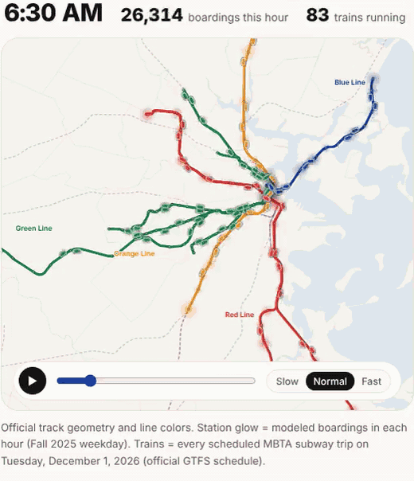

# Who the turnstiles miss — MBTA Ridership Gap

**Two official MBTA ridership datasets disagree about how many people ride the Blue Line — by up to 23%. This project reconciles them with a third, independent source and an animated system map, and finds where the gap comes from: riders changing lines underground, where no fare gate sees them.**

**→ Read the interactive data story: [shre0027.github.io/mbta-ridership-gap](https://shre0027.github.io/mbta-ridership-gap/)**

<a href="https://shre0027.github.io/mbta-ridership-gap/"></a>

*Morning rush on the T: every scheduled subway train (official GTFS), stations glowing with modeled boardings per hour.*

## The problem

The MBTA publishes two "official" ridership numbers for the same subway lines:

| | Dataset A — Monthly Ridership by Mode and Line | Dataset B — Rail Ridership by Season, Route and Stop |
|---|---|---|
| Built from | Fare-gate taps × fixed scaling factors | ODX trip model (taps + trip chaining + faregate passenger counters) |
| Grain | Line × month | Stop × direction × time period, one fall season |
| Used for | National Transit Database (NTD) reporting | Service planning |

In February 2025 a developer [asked on the MBTA Developers forum](https://groups.google.com/g/massdotdevelopers/c/u_JG__eP_ME) why Fall 2023 Blue Line ridership differed by 23.4%. MBTA's Office of Performance Management & Innovation (OPMI) replied that the methods differ, that **East Boston development** was the likely Blue Line driver, and that aligning the datasets is ongoing work.

## What I found

**1. The gap is not a one-off.** It appears in every fall season both datasets cover (weekday riders, monthly vs stop-level):

| Fall | Red | Orange | Blue | Green |
|---|---|---|---|---|
| 2018 | -6.5% | +3.0% | **-15.1%** | +6.5% |
| 2019 | -0.2% | +9.8% | **-10.6%** | +23.7% |
| 2023 | -7.4% | +5.2% | **-23.4%** | -16.1% |
| 2024 | -15.6% | -1.1% | **-21.9%** | +15.4% |
| 2025 | -10.4% | +1.8% | **-19.7%** | +15.9% |

The Blue Line is the only line the monthly dataset undercounts every single year — and it holds on weekends too: 15 of 15 comparisons across weekdays, Saturdays and Sundays, with weekend gaps of −23.7% to −27.5% since 2023 (`outputs/line_gap_by_daytype.csv`).

**2. The Blue Line gap sits downtown, not in East Boston.** Comparing raw gate taps (the input to Dataset A) with modeled boardings (Dataset B), station by station:

- At every regular Blue Line station — Maverick, Airport, Wonderland, Revere Beach — the model is a steady **~1.03–1.24× the taps**. That is the normal allowance for riders who don't tap.
- At the two transfer stations, **State and Government Center**, the model counts **~21,000–29,000 Blue Line boardings a day against only ~1,200–8,300 taps.** Riders transferring from Orange or Green never tap again, and the fixed survey "split factor" credits Blue with only ~10% of Government Center entries.
- These two stations hold **34–38% of all Blue Line boardings in every year from 2017 to 2025.**

**3. One real shift over time, and one silent swap.**
- **After COVID (helps explain the gap):** the model's uplift at regular stations rose from ~1.03–1.07× (2017–19) to ~1.16–1.24× (2023–25), consistent with OPMI's note that the model now uses faregate passenger counters to catch riders who don't tap. A fixed factor in the monthly method would not follow it — which fits the gap roughly doubling after 2019.
- **March 6, 2019 (data quality finding):** in the Gated Station Entries data, the Government Center split flipped overnight from **90% Blue / 10% Green to 10% Blue / 90% Green**, with no note in the data or documentation. Taps credited to the Blue Line there fell from ~6,700–7,000/day to ~400–800/day. This changes the tap data, not the gap between the two ridership datasets (the gap actually shrank from 2018 to 2019) — but anyone trending station entries across that date would see a ridership collapse that never happened.

**4. The bridge: the gap, split exactly into two parts.** Dividing the monthly Blue Line number by Blue Line gate taps gives the single factor it effectively applies (1.21–1.43×). With it, every season's gap splits exactly:

| Fall | Monthly (A) | + State & Gov Center | − Regular stations | = Stop-level (B) |
|---|---|---|---|---|
| 2018 | 65,961 | +18,303 | −6,616 | 77,647 |
| 2019 | 70,171 | +25,765 | −17,454 | 78,483 |
| 2023 | 48,385 | +19,609 | −4,801 | 63,193 |
| 2024 | 52,059 | +21,429 | −6,841 | 66,647 |
| 2025 | 50,339 | +19,864 | −7,507 | 62,695 |

The transfer stations always push the model up by 18–26k. The monthly method's blanket factor over-credits regular stations, partly offsetting it; as the model's uplift grew after COVID, that offset shrank from ~17k to ~5–8k, and the gap widened. *(This treats the monthly dataset as one factor on all taps — a model of OPMI's method, not their published breakdown.)*

**5. The Green Line swing comes from the monthly factor, not riders.** The stop-level model's Green Line factor (boardings ÷ taps) holds near 2.3–2.4× in 2018 and 2023–25. The monthly dataset's factor drops to mostly 1.7–2.0× from July 2023 to June 2024, then jumps to mostly 2.4–2.8× from August 2024 — so Fall 2023 lands below the model (−16%) and Fall 2024–25 above it (+15–16%). Red, Orange and Blue factors barely move. The jump coincides with the MBTA's new fare system launch on August 1, 2024 (contactless readers onboard Green Line trolleys); a NBC10/BU investigation reported the share of Green riders boarding at ungated stops rose from ~42–46% to 56.5% in September 2024. Separately, Fall 2019 stop-level data counts about half as many boardings at ungated surface stops as Fall 2018 (21k vs 44k), which is why the 2019 Green gap looks so large.

**6. System-wide, the same pattern.** Across all 61 gated subway stations (Fall 2025), modeled boardings ÷ gate taps has a median of 1.2×, and 54 stations sit between 1.0× and 1.5×. The outliers are the downtown hubs where lines meet underground: Government Center 5.1×, Park Street 4.3×, Downtown Crossing 3.2×, State 2.8× — plus South Station 1.9×, where Silver Line buses connect behind the gates.

**6b. The hub gap is a morning story.** Hour by hour (gate taps come in 30-minute periods), Government Center counts ~14 modeled boardings per tap at 8 AM and Park Street, Downtown Crossing and State ~7–9; by 5 PM all four are ~2–3×. Commuters change trains downtown on the way in without tapping; in the evening many trips start downtown. Regular stations sit near 1× all day — a commute-shaped pattern that fits transfers, not fare evasion.

**7. A third, independent source agrees.** In the MBTA's 2025 System-Wide Passenger Survey, 82% of Blue Line riders boarding at Government Center and 60% at State said they arrived on another subway line (vs 0–2% at regular Blue Line stations). At the four downtown hubs, the model counts 127,852 weekday boardings; gate taps × the normal 1.21 uplift explain 42,688 (33%); adding the survey's transfer share gives 124,580 — within 3%.

**7b. A tested fix.** Out of sample (calibrate on one fall, predict the next from gate taps alone): recalibrating the Blue Line factor once a year against the trip model cuts its mean absolute error from 18.1% to 6.3%. It makes no difference for Red (8.0% vs 8.0%) or Orange (4.2% vs 4.5%), and finer station-level factors did slightly worse — the fix is recalibration, not detail (`scripts/07_fix.py`, `outputs/fix_test.csv`).

**8. Why it matters.** The monthly dataset is published as the MBTA's `NTD_Reporting` service; NTD data feeds FTA formula programs (Section 5307 uses NTD service data including passenger miles). The MBTA's own Ridership Guide states that rapid-transit ridership is fare-gate data "adjusted with factors to account for behind the gate transfers, and non-interaction" — the exact factors this project reverse-engineers. (No funding impact is estimated.)

**Bottom line:** on the Blue Line, the datasets disagree mainly because of behind-the-gate transfers at State and Government Center, plus a larger non-tap allowance in the model after COVID. East Boston stations scale consistently and are not the driver. On the Green Line, the swing tracks shifts in the monthly dataset's own scaling. Along the way, the analysis surfaced three unflagged breaks in the public data.

**Caveat:** OPMI does not publish the exact factors behind Dataset A, so the transfer-allowance part of this decomposition is inferred from the published data, not confirmed by the MBTA.

## Reproduce it

```bash
pip install -r requirements.txt
python scripts/01_fetch.py     # downloads raw data from the MBTA Open Data Portal into data/raw/
python scripts/02_analyze.py   # writes reconciliation tables to outputs/
python scripts/04_system.py     # system-wide station test + rider-survey check + hourly boardings
python scripts/05_geo.py        # official GTFS shapes/stops -> projected map data
python scripts/06_trains.py     # every scheduled subway trip on one weekday -> real train positions (trains.json)
python scripts/07_fix.py        # out-of-sample test of a proposed fix (recalibrated factor)
python scripts/03_build_page.py # builds index.html (the data story) from outputs/ and site/template.html
```

**Checks:** `tests/check_outputs.py` asserts the key identities (Fall 2023 reproduces the forum figures, bridge parts sum to the gap, hubs reconcile within 10%, train schedule is sane). The monthly refresh runs it before committing, so a broken upstream file can't silently change the published numbers.

**Auto-refresh:** a GitHub Action (`.github/workflows/refresh.yml`) reruns the pipeline on the 8th of every month and commits updated outputs. The published page loads `outputs/story_data.json` live, so it picks up new monthly data without a redeploy. A new fall stop-level season is added with one line in `scripts/01_fetch.py`.

Validation: with the comparison window used here, Fall 2023 results reproduce the forum post's figures exactly.

## Repo map

- `scripts/` — fetch and analysis pipeline
- `index.html`, `site/template.html`, `trains.json` — the interactive data story (the hero map animates every scheduled subway trip from the official MBTA GTFS feed)
- `outputs/` — reconciliation tables (line gap, Blue Line stations, Blue Line summary and bridge, monthly factor by month, Green Line summary)
- `docs/data_dictionary.md` — every field used, from both datasets
- `docs/decision_log.md` — analysis decisions and why
- `docs/data_quality_log.md` — issues found in the source data

Data: MBTA Open Data Portal (OPMI), MBTA 2025 System-Wide Passenger Survey, MBTA Ridership Guide, MassDOT GTFS map, MassGIS town boundaries — used under the MassDOT Developers License Agreement. Line colors from the MBTA design system. Independent analysis, not affiliated with the MBTA.

*Shreyas Tayde · [shre0027.github.io](https://shre0027.github.io)*
